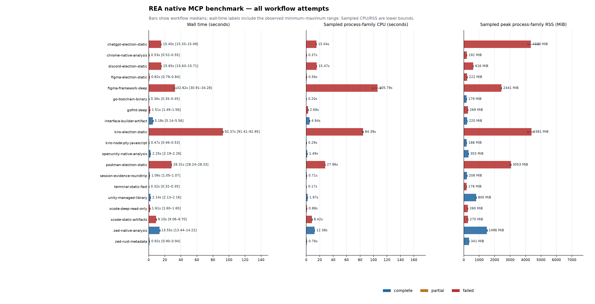
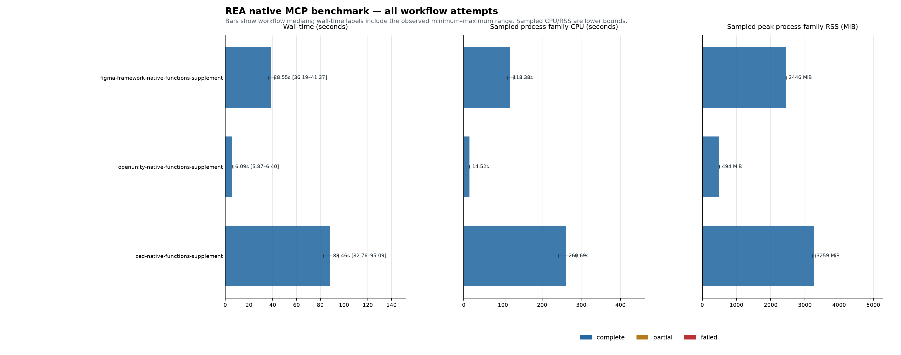

# Local application benchmarks — 25 October 2026

Native REA was measured against selected artifacts from 11 installed macOS
applications and the Go toolchain. The main suite ran 19 workflows five times,
using a fresh REA process and isolated provider cache for every sample. It
completed all 95 planned samples: 40 workflow samples passed and 55 retained failures.
Of 1,050 MCP requests, 865 succeeded and 185 failed. These are measurements of
this build and host, not a claim that every advertised feature works.

Three supplemental series bring the total to **125 samples, 25 workflows and
1,750 MCP requests**: 60 samples and 1,550 requests succeeded; 65 samples and
200 requests retained failures. The suite exercised **69 of 209 advertised
tools**. Each workflow was repeated five times. A passed workflow means its
requested calls and process cleanup completed; output quality has separate
checks below.

The [full results table](report.md) includes time, CPU, memory and failure costs
for every workflow. [Process samples](workflows.csv), [individual calls](calls.csv),
and [machine-readable statistics](summary.json) support further analysis.

Bars show medians; whiskers show observed min/max. Red denotes a workflow with
failed calls. Those costs are failure measurements, not completed analysis.

## What the results show

- Bundle inventory, thin Mach-O metadata, Go metadata, Rust metadata, selected
  managed-library inspection, compiled Interface Builder decoding, and a small
  JavaScript graph workflow completed in all five rounds.
- Larger native inputs cost substantially more. Zed's bundle/native inventory
  workflow took a median **13.55 s**, **12.38 CPU s** across observed processes,
  and **1,496 MiB** peak family RSS. OpenUnity's equivalent selected workflow
  took **2.25 s**, **1.49 CPU s**, and **303 MiB**. Their inputs and inventories
  differ, so this is not an algorithmic scaling comparison.
- Full Electron source analysis did not complete for any selected ASAR.
  Discord and Postman hit provider timeouts; Figma rejected ASAR metadata;
  ChatGPT and Kiro exceeded the sampled **4 GiB** family-RSS guard. Their costs
  are included, with the failure attached.
- The native provider rejected the universal Mach-O executables selected from
  Terminal, Chrome and Discord. Bundle inspection still returned useful facts.
  Thin-slice extraction was not part of the frozen workflows.
- Caller/callee queries failed Evidence validation in Xcode, Figma Framework
  and gofmt. Several other deep operations reported unsupported capabilities.
  Fast failure is not successful analysis.
- Each fresh process returned **3,245,006 bytes** from `tools/list`. Discovery
  bytes and timings are recorded separately from analysis calls. Bytes are
  not presented as model tokens.

## Applications and selected work

Versions come from the applications' own bundle metadata. Paths, selected file
sizes and SHA-256 digests are in the provenance manifests.

| Application | Observed version | Selected work and outcome |
| --- | --- | --- |
| Terminal | 2.15 | Bundle inventory; universal executable rejected by the selected provider. |
| Zed Preview | 1.25.1 | Bundle, thin Mach-O, signature, procedures, strings and Rust metadata completed; larger function pass described below. |
| OpenUnity | 0.1.0 | Bundle, thin Mach-O, signature, procedures and strings completed; larger function pass described below. |
| Google Chrome | 155.0.8059.86 | Bundle inventory; universal executable rejected. |
| Xcode | 27.0 | Thin launcher, plist, SQLite and Evidence work; bundle-wide IB/assets scans hit the directory-entry bound; deep native operations had unsupported/error results. |
| Discord | 0.0.415 | Bundle, Electron metadata and ASAR inventory; universal executable rejected and source analysis timed out. |
| Figma | 126.9.13 | Asset catalog returned 27 records; ASAR metadata rejected; selected Electron Framework deep analysis had mixed results. |
| Postman | 12.32.2 | Bundle/Electron inventory completed; ASAR source analysis timed out. |
| ChatGPT.app | 26.1016.51333 | Bundle/Electron inventory completed; ASAR source analysis exceeded the RSS guard. Bundle identifier was `com.openai.codex`. |
| Kiro | 1.4.26 | ASAR source analysis exceeded the RSS guard. A separate two-file `node-pty/lib` JavaScript graph/trace workflow completed. |
| Unity | 7000.0.0a8 | Selected `UnityEngine.CoreModule.dll`, compiled nib/keyed archive and asset work completed. |
| Go toolchain | 1.26.5 | `gofmt` metadata completed; native deep analysis returned degraded pseudocode and Evidence failures. |

The successful Kiro JavaScript case uses two files of 355 and 911 bytes. It does
not demonstrate whole-application JavaScript analysis. The successful managed
case uses a 2,587,136-byte DLL; the native Zed and Figma Framework inputs are
175,383,888 and 194,960,016 bytes respectively.

## Main suite resource costs

These are medians across five fresh processes. CPU is summed over observed
processes and may exceed elapsed time when work runs concurrently. RSS is the
largest simultaneous sum of observed process RSS within each workflow.

| Workflow | Passed | Elapsed | Family CPU | Peak family RSS |
| --- | ---: | ---: | ---: | ---: |
| Go metadata | 5/5 | 0.36 s | 0.20 s | 179 MiB |
| Zed Rust metadata | 5/5 | 0.92 s | 0.76 s | 341 MiB |
| OpenUnity inventory/native metadata | 5/5 | 2.25 s | 1.49 s | 303 MiB |
| Unity managed library | 5/5 | 2.14 s | 1.97 s | 800 MiB |
| Unity compiled UI artifacts | 5/5 | 5.18 s | 4.94 s | 220 MiB |
| Zed inventory/native metadata | 5/5 | 13.55 s | 12.38 s | 1,496 MiB |
| Figma Framework deep operations | 0/5 | 32.82 s | 105.79 s | 2,441 MiB |
| Postman Electron source analysis workflow | 0/5 | 28.31 s | 27.96 s | 3,053 MiB |
| ChatGPT Electron workflow, RSS stopped | 0/5 | 15.40 s | 15.04 s | 4,336 MiB |
| Kiro Electron workflow, RSS stopped | 0/5 | 92.37 s | 84.39 s | 4,381 MiB |

Failed workflow times include useful calls made before or after an ordinary
tool error. Resource-limit stops abort the remaining dependent calls. See the
[complete table](report.md) for all 19 workflows, min/max elapsed times, OS CPU
accounting and instrumentation CPU.

## Native selected-address analysis

The supplement exercises five selected addresses in each of Zed, OpenUnity and
Figma's Electron Framework: assembly, instruction decoding, references, three
pseudocode requests, direct bytes, and batch decompilation. All **15 workflow
samples and 630 recorded MCP calls** returned success. These are selected
address workloads; their function boundaries remain unverified.

| Target | Elapsed median [min–max] | Family CPU median | Peak family RSS median |
| --- | ---: | ---: | ---: |
| OpenUnity | 6.09 s [5.87–6.40] | 14.52 s | 494 MiB |
| Figma Framework | 38.55 s [36.19–41.37] | 118.38 s | 2,446 MiB |
| Zed | 88.46 s [82.76–95.09] | 260.69 s | 3,259 MiB |

`procedure_references` consumed **64.2%** of measured analysis-call wall time
for OpenUnity, **80.7%** for Figma and **82.0%** for Zed. The slowest individual
reference calls took 3.92, 32.95 and 79.14 seconds respectively. The measurements
locate an expensive operation; they do not identify its internal cause. Family
CPU exceeding elapsed time indicates concurrent CPU work across threads or
processes; these timings do not attribute that work to a particular component.

Retained-session pseudocode requests were much cheaper after the first request
for an address. Each cell below summarizes 25 calls: five addresses across five
fresh processes.

| Target | First request | Second request | Third request |
| --- | ---: | ---: | ---: |
| OpenUnity | 14.08 ms | 1.36 ms | 2.77 ms |
| Figma Framework | 93.21 ms | 1.43 ms | 1.30 ms |
| Zed | 97.18 ms | 2.33 ms | 3.01 ms |

Serialized pseudocode responses ranged from about 19–184 kB. Response bytes
include Evidence and protocol overhead; they are not pseudocode length or
model tokens. The [per-call table](native-functions/calls.csv) and
[full supplement](native-functions/report.md) retain exact sizes and costs.

The [formal output checks](../local-applications-2026-10-25-native-functions-formal-validation.json)
found all **75 direct 256-byte reads** matched independently mapped file bytes.
Pseudocode hashes and instruction counts stayed stable across repeats and
rounds, and batch items reported success. These establish byte provenance and
repeatability, not semantic correctness.

**None of the 15 addresses has an independently established function end.**
The frozen plan initially mislabeled some planning intervals as independent
extents. Adjacent symbols and unwind starts do not prove function ends. The
[corrected qualification facts](../local-applications-2026-10-25-native-functions-qualification.json)
and formal validation retain this limitation without changing the measured
plan. For example, Figma's first planning value was 38,352 bytes, while the
distance to the next selected exported start is 42,448 bytes; neither is a
verified function extent. Nonempty, stable output must not be treated as a
complete or correct function decompilation.

## Additional inventory checks

Ten further samples exercised `binary_overview`, `list_names`,
`find_xrefs_to_name` and `inspect_with_objdump`. Of 55 MCP requests, 40 succeeded
and 15 failed; no workflow passed in full.

- OpenUnity's inventory workflow took a median **1.11 s**, **0.81 CPU s** and
  **281 MiB**. `binary_overview` succeeded. The provider reported
  `capability_unavailable` for `list_names` and `find_xrefs_to_name` in all rounds.
- gofmt's objdump workflow took **0.37 s**, **0.21 CPU s** and **185 MiB**.
  The installed Apple LLVM objdump rejected this header operation on the Mach-O
  input. REA retained `unreadable_output` as the execution failure and surfaced
  `cleanup_incomplete` after an owned process-group signal was denied. This is
  an observed failed external-tool workflow, not successful GNU objdump coverage.

See the [inventory results](inventory/report.md) for every sample and error.

A final five-sample lane inspected PE resources in Unity's managed DLL. All
15 calls succeeded, with workflow medians of **0.28 s**, **0.14 CPU s** and
**178 MiB**. It found one resource after examining three directory entries.
The reader retained the opaque payload but reported malformed `RT_VERSION`
alignment, leaving decoded version metadata unknown. Successful inventory
does not imply successful decoding of every embedded structure. See the
[PE resource results](pe-resources/report.md) and
[payload validation](../local-applications-2026-10-25-pe-resources-validation.json).

## Output checks and coverage

The main suite invoked **64 distinct tools** from a catalog advertising 209.
Forty-three tools had only successful observed calls, four had mixed results,
and seventeen had only failures in the main suite. Across all four series,
**69 tools** were exercised: **45 success-only, four mixed and 20 failure-only**.
The remaining 140 have explicit scope, input or selection reasons. The
[tool coverage map](../local-applications-2026-10-25-coverage.json) records every
advertised tool, its measured outcomes or the reason it was excluded or left
unmeasured. Advertised count is not an implemented-feature count. This suite
does not exercise live attachment, injection, target execution, device control,
network capture or unrelated provider installations.

The [bounded result audit](../local-applications-2026-10-25-audit.json) records
counts, delivery/coverage facts and limitations without publishing application
source or decompiler output. The
[first-round output checks](../local-applications-2026-10-25-validation.json)
add independent byte checks for the selected Xcode and Figma addresses:

- Provider bytes matched direct reads at offsets derived from Mach-O mappings.
- Repeated pseudocode hashes agreed within the same session. The initially
  selected Xcode address returned two instructions and 70 characters of
  pseudocode; Figma returned 403 linear instruction entries and 71 characters
  of pseudocode. These results do not establish performance on substantial,
  independently bounded functions.
- gofmt's selected pseudocode contained a bad-instruction halt. A successful
  protocol response did not establish a usable decompilation.
- Evidence export followed by import in the same session added zero duplicate
  records. Fresh-process reconstruction was not tested.

## Measurement conditions

- Apple M1 Pro, 10 logical CPUs, 32 GiB RAM, macOS 27.2 build 26B5101f,
  MacBookPro18,1, ARM64.
- Optimized macOS ARM64 release artifacts from commit
  `6cb6773294ee741c8555aebf5ddebbe7915b0a67`. REA SHA-256:
  `1a5ce65a55351df5e12bb25ab0f1a858cef8d3c6e1f8ceb29fa0735a847a08ce`.
  Worker SHA-256:
  `7246d779dba93b413686c1545473b393a94a37f925819aed9e82c4157cb50cfc`.
- Main measurement UTC: 14:23:56–14:42:50. Python 3.13.7, psutil 7.2.2.
  The exact main runner is pinned in commit `3b56397`; its hash is also in the
  main before/after manifests. Later readability changes and function-specific
  labels apply to the supplemental series.
- All four series ran between 14:23:56 and 15:12:37 UTC. The native and
  inventory supplements have their own before/after manifests and unchanged
  executable digests. Inventory and PE resources used a 30 s per-call deadline;
  the other series used 120 s. The RSS guard and sampling policy were shared.
- Fresh process, isolated HOME/XDG/config/provider-cache directories for every
  sample. Even rounds reverse workflow order. Calls within a workflow share a
  session. Only `#2`/`#3` repetitions measure retained-session reuse.
- Filesystem cache was uncontrolled and warmed by qualification and hashing.
  Neither first-round nor later-round results represent an OS-cold benchmark.
- The host was on battery at the initial capture, with background load and no
  thermal warning recorded. CPU frequency, scheduler placement and other host
  work were not controlled.
- Per-call deadline: 120 s; sampled family-RSS guard: 4 GiB. The guard can
  overshoot. The largest main-suite observed peak was about **4,830 MiB**.
  The maximum sampling gap was **188.1 ms**, despite a requested 5 ms interval.
- Recursive process sampling can miss short-lived children, exit tails and
  peaks. Summed RSS can count shared pages repeatedly. Per-call zero samples
  mean unobserved usage. OS `wait4` accounting is retained separately and may
  include waited descendants; the two CPU figures are not added together.
- Harness CPU includes sampling, JSON handling and per-call receipt writes.
  For example it used a median 7.18 CPU s during the 13.55 s Zed workflow.
  Timings are instrumented; overhead was not subtracted or independently
  calibrated. Aggregate report writes between workflows are outside those
  process timings.
- Nine RSS-stop receipts retained a process-group `PermissionError` warning.
  None recorded remaining observed descendants or live reader threads after
  cleanup. Those warnings remain in raw receipts; cleanup is not described as
  error-free.
- Before/after selected-file hashes and identities were unchanged. Only
  explicitly selected files, canonical executables, bundle metadata and tooling
  were checked. This does not freeze or verify every file in each app bundle.

This run contains no fresh TypeScript baseline. Actual agent token usage,
energy, physical disk bytes, CPU hardware counters, full semantic correctness,
and complete recursive application coverage were not measured. Faults, block
operation counts and context switches are available in the process CSV; block
operations are not physical disk-byte measurements.

## Follow-up priorities

1. Restore usable native Evidence for caller/callee queries. Their repeated
   integrity failures block dependent workflows before performance can be judged.
2. Profile reference lookup on the three selected native inputs. It dominates
   the measured selected-address cost; distinguish index construction, traversal,
   serialization and Evidence work before choosing an optimization.
3. Establish independent function boundaries and semantic output checks. Keep
   the current addresses as degraded coverage until those checks exist.
4. Bound large Electron/ASAR analysis more effectively and retain useful partial
   results. Timeouts and RSS stops prevented completed analysis on these inputs.
5. Add explicit universal Mach-O slice selection and inspect the external-tool
   cleanup failure. Preserve the errors as regression cases.
6. Measure catalog/context cost with an actual client and tokenizer. The 3.25 MB
   discovery response is measurable; its agent-token cost remains unknown.

These are work items suggested by the measurements. No performance fix or fresh
TypeScript comparison is claimed by this report.

## Reproduce and inspect

Use the [runner instructions](../../../scripts/benchmarks/README.md) with the
[main plan](../local-applications-2026-10-25-plan.json), the pinned release
executables, and a new work directory. Capture provenance before and after even
when a measured failure makes the runner exit with status 1.

The [before manifest](../local-applications-2026-10-25-before.json),
[after manifest](../local-applications-2026-10-25-after.json), and
[compact raw receipts](../local-applications-2026-10-25-raw.json) retain selected
input identities, hashes, request arguments, timings and errors. Plan digests in
the raw aggregate use canonical JSON; provenance records the plan file's byte
digest. Full MCP responses remain in the local benchmark work directory because
they contain application strings and decompiled code.

Supplemental artifacts:

| Series | Plan | Provenance | Compact receipts | Results |
| --- | --- | --- | --- | --- |
| Native addresses | [Plan](../local-applications-2026-10-25-native-functions-plan.json) | [Before](../local-applications-2026-10-25-native-functions-before.json), [after](../local-applications-2026-10-25-native-functions-after.json) | [JSON](../local-applications-2026-10-25-native-functions-raw.json) | [Report](native-functions/report.md), [CSV](native-functions/workflows.csv) |
| Inventory | [Plan](../local-applications-2026-10-25-inventory-plan.json) | [Before](../local-applications-2026-10-25-inventory-before.json), [after](../local-applications-2026-10-25-inventory-after.json) | [JSON](../local-applications-2026-10-25-inventory-raw.json) | [Report](inventory/report.md), [CSV](inventory/workflows.csv) |
| PE resources | [Plan](../local-applications-2026-10-25-pe-resources-plan.json) | [Before](../local-applications-2026-10-25-pe-resources-before.json), [after](../local-applications-2026-10-25-pe-resources-after.json) | [JSON](../local-applications-2026-10-25-pe-resources-raw.json) | [Report](pe-resources/report.md), [CSV](pe-resources/workflows.csv) |

The [provenance audit](../local-applications-2026-10-25-provenance-validation.json)
checks selected-file and tooling identities across all four series. The
catalog has one canonical JSON-RPC digest across all samples; the coverage map
also records the distinct file digest of its local catalog wrapper.
